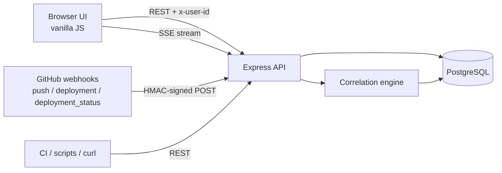
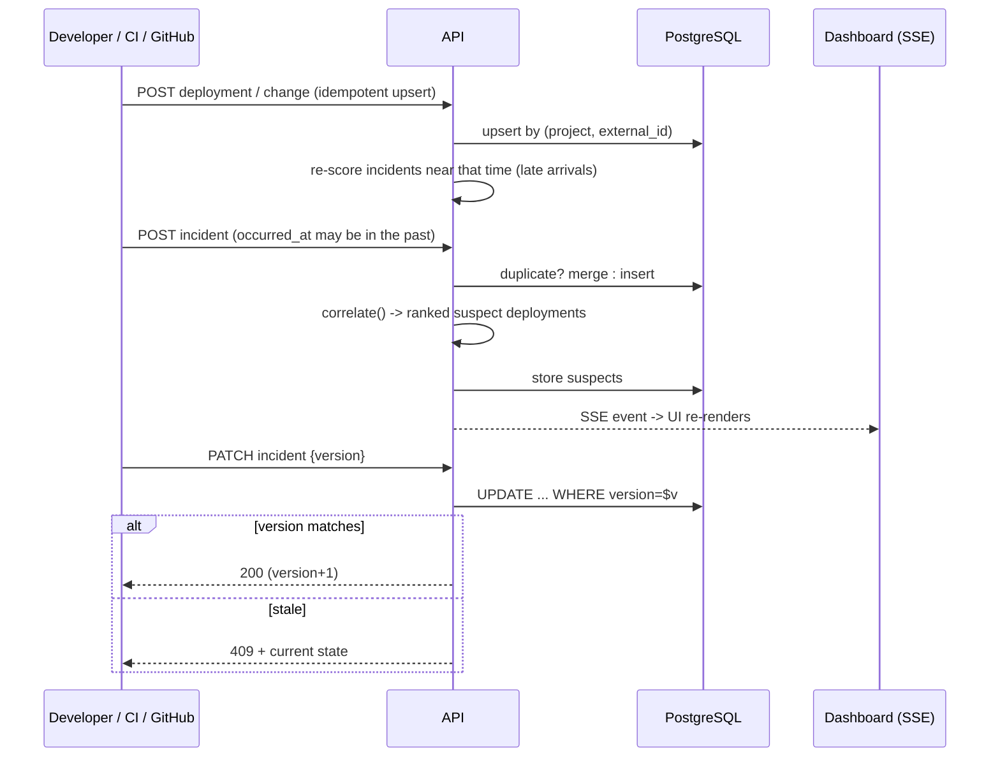

# Who Broke the Build?

Incident tracking and deployment monitoring platform. When production breaks, it shows **which deployment or change most likely caused it**, keeps an ordered timeline of events (even when they arrive late or out of order), and lets several people work on the same incident safely.

**Stack:** Node.js + Express (REST) · PostgreSQL · vanilla JS frontend served by Express · Server-Sent Events for real-time · Docker Compose.

## Features

| # | Requirement | Where |
|---|-------------|-------|
| 01 | Create/manage projects | `POST/GET/DELETE /api/projects` |
| 02 | Record deployments, changes, incidents | `/deployments`, `/changes`, `/incidents` |
| 03 | Per-project event timeline | `GET /api/projects/:id/timeline` (sorted by *when it happened*) |
| 04 | Link incidents to likely deployments/changes | auto-correlation + manual `POST /incidents/:id/suspects` |
| 05 | Severity, status, assignees, resolution | `PATCH /api/incidents/:id` |
| 06 | Multi-user updates | append-only `incident_updates` + optimistic locking on edits |
| 07 | Dashboard | `GET /api/projects/:id/dashboard` (open, MTTR, recurring issues, suspect deployments) |
| 08 | Duplicate / delayed / conflicting events | see *Event handling* below |
| Bonus | GitHub webhooks, real-time (SSE), RBAC, dedup, audit logs | all included |

## Quick start (Docker, recommended)

```bash
git clone <your-repo-url> && cd who-broke-the-build
docker compose up --build
# open http://localhost:3000
```
Load demo data (second terminal): `npm install && npm run seed` (needs Node 18+).

## Run without Docker

```bash
# 1. start Postgres and create a DB
createdb wbtb                       # or: docker run -d -p 5432:5432 -e POSTGRES_PASSWORD=postgres -e POSTGRES_DB=wbtb postgres:16
# 2. configure + run
cp .env.example .env                # edit DATABASE_URL if needed
export $(grep -v '^#' .env | xargs)
npm install
npm start                           # schema is applied automatically on boot
npm run seed                        # optional demo data
```

## Architecture



* **Express API** - validation, RBAC, idempotent upserts, optimistic locking, SSE fan-out.
* **Correlation engine** (`correlate()` in `src/index.js`) - scores deployments against an incident.
* **PostgreSQL** - source of truth; schema in `db/schema.sql`, applied on startup.

## Database schema

```mermaid
erDiagram
  USERS ||--o{ PROJECTS : creates
  PROJECTS ||--o{ DEPLOYMENTS : has
  PROJECTS ||--o{ CHANGES : has
  PROJECTS ||--o{ INCIDENTS : has
  DEPLOYMENTS ||--o{ CHANGES : ships
  INCIDENTS ||--o{ INCIDENT_SUSPECTS : "linked to"
  INCIDENTS ||--o{ INCIDENT_UPDATES : has
  USERS ||--o{ INCIDENT_UPDATES : writes
  USERS ||--o{ AUDIT_LOGS : performs
  USERS { int id PK; text name; text role "admin|developer|viewer" }
  PROJECTS { int id PK; text name UK; text repo_url }
  DEPLOYMENTS { int id PK; int project_id FK; text external_id "UK with project"; text version; text environment; text status; text commit_sha; timestamptz deployed_at; timestamptz received_at }
  CHANGES { int id PK; int project_id FK; int deployment_id FK; text external_id; text commit_sha; text message; text author; timestamptz committed_at }
  INCIDENTS { int id PK; int project_id FK; text fingerprint; text title; text severity; text status; int_array assignees; text resolution; timestamptz occurred_at; timestamptz reported_at; timestamptz resolved_at; int report_count; int version "optimistic lock" }
  INCIDENT_SUSPECTS { int id PK; int incident_id FK; text kind "deployment|change"; int ref_id; numeric score; text reason; text source "auto|manual" }
  INCIDENT_UPDATES { int id PK; int incident_id FK; int user_id FK; text kind; text body; text client_id "idempotency" }
  AUDIT_LOGS { int id PK; int user_id FK; text action; text entity; int entity_id; jsonb details }
```

## Application workflow



Incident lifecycle: `open -> investigating -> identified -> resolved` (resolution text required; can be reopened).

## Failure <-> deployment correlation

For an incident that started at `T`, every non-cancelled deployment in `[T-48h, T+5min]` is scored 0-100:

| Signal | Points |
|--------|--------|
| Recency: `60 * exp(-hours_before_incident / 6)` | 0-60 |
| Production environment | +15 |
| Deployment `failed` / `rolled_back` | +15 |
| Keywords from incident title/description found in commit messages or deployment notes | +10 each, max 20 |

Scores below 20 are dropped. Results are ranked on the incident page and aggregated on the dashboard ("most suspected deployments"). Humans can pin a deployment or change manually (score 100, never overwritten by the engine). Recurring issues are found by grouping incidents on a normalised-title fingerprint.

## Event handling (requirement 08)

| Problem | Handling |
|---------|----------|
| **Duplicate events** | `external_id` unique per project; re-sending upserts instead of inserting. Incident reports with the same title while one is still open are merged (`report_count++`). `client_id` makes update posts idempotent. |
| **Delayed events** | Every record has `occurred_at` (when it happened) and `received_at` (when we heard). Timeline sorts by the former. A late deployment/change triggers re-correlation of incidents in its window. |
| **Incomplete records** | Deployment `version`, `commit_sha`, etc. are nullable; a later event with the same `external_id` fills the gaps (`COALESCE`). |
| **Out-of-order status** | A late `pending` can never overwrite a final deployment status. |
| **Simultaneous edits** | Comments/updates are append-only (never conflict). Field edits use optimistic locking (`version`); a stale write gets `409` with the current state. |

## API reference

All `/api` routes except health, SSE and the webhook take an `x-user-id` header (seeded users: 1 admin, 2-3 developers, 4 viewer; defaults to 1). Viewers are read-only; deleting a project and reading audit logs is admin-only.

| Method | Path | Purpose |
|--------|------|---------|
| GET | `/api/users` | seeded users |
| GET/POST | `/api/projects` | list / create |
| GET/DELETE | `/api/projects/:pid` | get / delete (admin) |
| GET/POST | `/api/projects/:pid/deployments` | list / record (upsert) |
| GET/POST | `/api/projects/:pid/changes` | list / record (upsert) |
| GET | `/api/projects/:pid/timeline` | merged event timeline |
| GET/POST | `/api/projects/:pid/incidents` | list (`?status=&severity=`) / report |
| GET | `/api/incidents/:id` | incident + updates + suspects |
| PATCH | `/api/incidents/:id` | edit (requires `version`) |
| POST | `/api/incidents/:id/updates` | add comment |
| POST | `/api/incidents/:id/correlate` | re-run correlation |
| POST / DELETE | `/api/incidents/:id/suspects[/:sid]` | pin / remove suspect |
| GET | `/api/projects/:pid/dashboard` | summary stats |
| GET | `/api/projects/:pid/stream` | SSE real-time events |
| POST | `/api/webhooks/github/:pid` | GitHub webhook |
| GET | `/api/audit-logs` | audit trail (admin) |

Example:
```bash
curl -X POST localhost:3000/api/projects/1/deployments -H 'content-type: application/json' \
  -d '{"external_id":"run-42","version":"v2.0.0","commit_sha":"abc1234","deployed_by":"ravi"}'
curl -X POST localhost:3000/api/projects/1/incidents -H 'content-type: application/json' \
  -d '{"title":"Checkout returns 500","severity":"critical","occurred_at":"2026-10-15T08:30:00Z"}'
```

## GitHub webhook (bonus)

1. Repo -> Settings -> Webhooks -> Add webhook.
2. Payload URL: `https://<your-host>/api/webhooks/github/<projectId>`; content type `application/json`.
3. Secret: any string; set the same value as `GITHUB_WEBHOOK_SECRET` on the server.
4. Events: **Pushes**, **Deployments**, **Deployment statuses**.

Commits become *changes* (`commit:<sha>`), deployments become *deployments* (`gh:<id>`), so GitHub redelivery is harmless.

## Deploying (Render example)

1. Push this repo to GitHub.
2. Render -> New -> **PostgreSQL** (free tier). Copy the *Internal Database URL*.
3. Render -> New -> **Web Service** -> connect the repo -> Runtime **Docker**.
4. Environment variables: `DATABASE_URL` = the URL from step 2, `PGSSL` = `true`, optionally `GITHUB_WEBHOOK_SECRET`.
5. Deploy. Put the live URL here: `https://<your-app>.onrender.com`.

(Railway / Fly.io work the same way: Dockerfile + `DATABASE_URL`.)

## Design decisions and limitations

* Auth is intentionally simple (seeded users, `x-user-id`) to demonstrate RBAC; production would use JWT/OAuth.
* SSE uses an in-process event bus; with multiple instances, swap in Postgres `LISTEN/NOTIFY` or Redis.
* Correlation is a transparent heuristic, not ML; weights are in `correlate()` and easy to tune.
* Frontend is dependency-free vanilla JS to keep setup to one command; the REST API works with any React/Next.js client.
